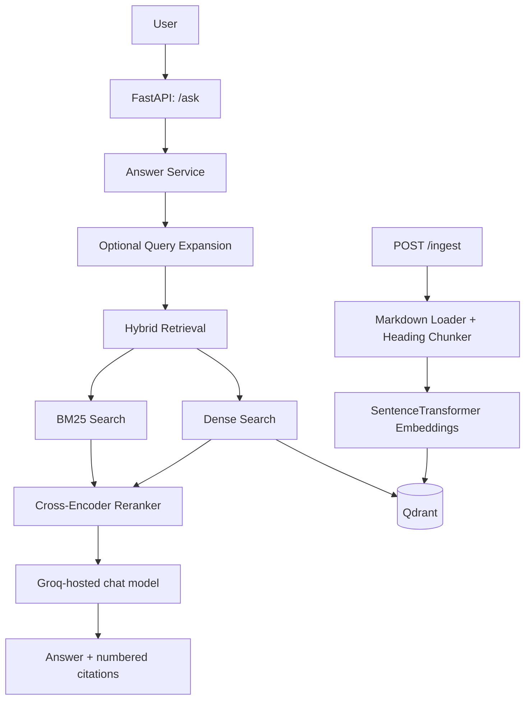

# DevDocs Copilot

A production-oriented Retrieval-Augmented Generation (RAG) assistant for FastAPI's Markdown documentation. It combines dense vector search, BM25 keyword retrieval, Reciprocal Rank Fusion (RRF), optional multi-query retrieval, cross-encoder reranking, grounded answer generation, and source citations.

## Architecture



## Features

- Markdown ingestion with source path and heading metadata.
- Heading-aware chunks that preserve fenced code blocks.
- Dense retrieval through Qdrant and Sentence Transformers.
- BM25 keyword retrieval and hybrid ranking with RRF.
- Optional query expansion and multi-query result fusion.
- Cross-encoder reranking before generation.
- Citation validation against the sources supplied to the model.
- FastAPI endpoints for health checks, indexing, and asking questions.
- Docker Compose for the API and persistent local Qdrant storage.
- Pytest coverage and GitHub Actions CI.

## Requirements

- Python 3.11 for local development.
- Docker Desktop with Docker Compose for Qdrant/containerized execution.
- A Groq API key for answer generation. Indexing and `/health` do not require the key.
- A Markdown corpus under `data/raw/`. The FastAPI Markdown files used during evaluation should be present in that directory. The optional local upstream trees under `data/source/` and `data/raw/docs_src/` are not committed.

## Run with Docker Compose

1. Create your local environment file and add your key:

   ```powershell
   if (-not (Test-Path .env)) { Copy-Item .env.example .env }
   notepad .env
   ```

   Set `GROQ_API_KEY` in `.env`. Do not commit `.env`.

2. Build and start the API and Qdrant:

   ```powershell
   docker compose up --build -d
   ```

3. Build the vector index from the Markdown corpus. This is a full re-index and replaces the configured Qdrant collection after embeddings are prepared:

   ```powershell
   Invoke-RestMethod -Method Post -Uri http://localhost:8000/ingest
   ```

4. Check the API and ask a question:

   ```powershell
   Invoke-RestMethod -Uri http://localhost:8000/health

   $body = @{ question = "How do I define a path parameter in FastAPI?" } | ConvertTo-Json
   Invoke-RestMethod -Method Post -Uri http://localhost:8000/ask `
     -ContentType "application/json" -Body $body
   ```

5. Open interactive API documentation at <http://localhost:8000/docs>.

Stop services with `docker compose down`. Qdrant data persists in the named `qdrant_storage` volume; `docker compose down -v` deletes that volume.

## Run locally

Start Qdrant first (for example, with `docker compose up -d qdrant`), then install the Python dependencies and configure `.env` as described above.

```powershell
python -m pip install -r requirements.txt
uvicorn src.api.main:app --reload
```

Run `POST /ingest` before asking questions. The embedding model is downloaded by Sentence Transformers on first use. Set `ENABLE_QUERY_EXPANSION=true` to enable LLM-based query expansion; it can increase token usage and latency.

## API

- `GET /health` — process liveness check; it does not verify Qdrant or model readiness.
- `POST /ingest` — rebuild the configured Qdrant collection from `data/raw/**/*.md`.
- `POST /ask` — accepts `{"question": "...", "source_path": null}` and returns the answer, source metadata, citation validation, and retrieval diagnostics.

`source_path`, when provided, must match the relative source path recorded during ingestion. The API has no authentication; do not expose it directly to the public internet without adding access controls and rate limits.

## Evaluation evidence

The repository's evaluation artifacts are retained under `evals/`, with the retrieval comparison and RAG quality checkpoint documented in:

- [`docs/retrieval_evaluation_multi_query.md`](docs/retrieval_evaluation_multi_query.md)
- [`docs/rag_quality_checkpoint.md`](docs/rag_quality_checkpoint.md)
- [`docs/DECISIONS.md`](docs/DECISIONS.md)

The reports document measured results from the local evaluation run. Re-run the evaluation scripts when the corpus, embedding model, retriever settings, or prompts change. Cache files are local evaluation aids and are not required to run the API.

## Tests

```powershell
python -m pytest -q tests
python -m compileall -q src tests
```

GitHub Actions runs the same compile and pytest checks on pushes and pull requests to `master` and `main`.

## Configuration

See [`.env.example`](.env.example). Important settings are `GROQ_API_KEY`, `GROQ_MODEL`, `QDRANT_URL`, `QDRANT_COLLECTION_NAME`, `EMBEDDING_MODEL`, and `ENABLE_QUERY_EXPANSION`.

## Known limitations

- The initial corpus and embedding model are optimized for the FastAPI documentation used in this project; the embedding model is English-oriented.
- Query expansion is disabled by default to control additional LLM cost and latency.
- Re-ingestion replaces the configured Qdrant collection; run it intentionally.
- The service validates citation IDs but is not a substitute for a full production security, observability, and load-testing review.
